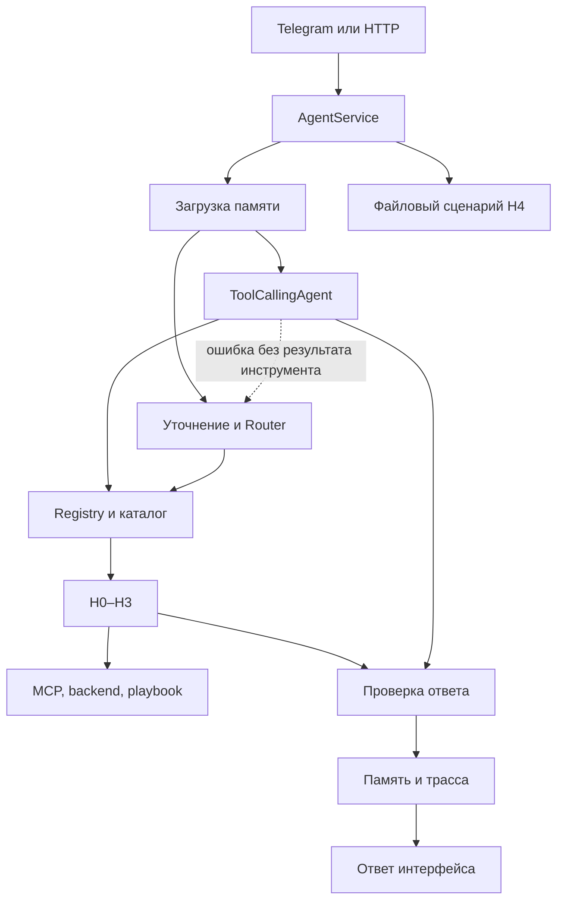

# Устройство агента AI-buddy

Агент обслуживает H0–H4 через Telegram и клиентский HTTP API. Ниже описана реализация
ветки `improved_structure`, а не целевая структура из ранних этапов проекта.

## Карта пакетов

```text
agent/
├── buddy/
│   ├── __main__.py              CLI: запуск и offline smoke
│   ├── app.py                   жизненный цикл, подключения, HTTP и polling
│   ├── bootstrap.py             сборка продуктовых сервисов
│   ├── config.py                настройки из окружения
│   ├── contracts.py             Context, RouteDecision, ScenarioResult, ExecutorResponse
│   ├── presentation.py          модель действия интерфейса
│   ├── runtime.py               зависимости demo/live и источник времени
│   │
│   ├── orchestration/
│   │   ├── service.py           AgentService: фасад операций приложения
│   │   ├── catalog.py           закрытый каталог сценариев
│   │   ├── registry.py          проверка роли и вызов обработчика сценария
│   │   ├── graph.py             порядок шагов LangGraph и проверка ответа
│   │   ├── state.py             состояние одного хода
│   │   ├── agent_loop.py        ToolCallingAgent: LLM → инструменты → ответ
│   │   ├── interactions.py      состояние взаимодействий в текущем процессе
│   │   └── router/
│   │       ├── service.py       классификация запроса и проверка результата LLM
│   │       └── rules.py         маршрутизация без LLM
│   │
│   ├── bot/
│   │   ├── handlers.py          /start, /help, создание dispatcher
│   │   ├── registration.py      регистрация остальных обработчиков
│   │   ├── commands.py          /demo, /ask, /stats, /settings, /reset
│   │   ├── messages.py          обработка обычного текста
│   │   ├── callbacks.py         обработка нажатий кнопок
│   │   ├── session.py           личный чат и доверенный Context
│   │   ├── rendering.py         клавиатуры, отправка, HTML/plain fallback
│   │   ├── identity.py          привязка Telegram к профилю backend
│   │   ├── teamcard.py          загрузка карточки команды
│   │   ├── equator.py           загрузка презентации, доставка наставнику
│   │   └── stage_two.py         совместимость старых импортов
│   │
│   ├── channels/               общий API каналов, HTTP, репозитории и Telegram adapter
│   ├── brief/                  H0: сбор, ранжирование, расписание и состояние брифа
│   ├── access/                 H1: проверки, заявки и мониторинг доступов
│   ├── team/                   H2: восемь типов вопросов, FAQ и эскалация
│   ├── rag/                    H3: playbook, ingestion, BM25/vector/RRF
│   ├── equator/                H4: чтение PDF/PPTX, проверки, версии и рекомендации
│   ├── mcp_hub/                discovery, транспорт, OAuth, фикстуры и политики MCP
│   ├── data/                   контракты и реализации backend/seed
│   ├── llm/                    LLM-клиент и выбор провайдера
│   ├── memory/                 окно диалога, уточнения, Redis/in-memory
│   ├── demo/                   роли, шаги сценария и синтетический Runtime
│   ├── scheduler/jobs.py       фоновые циклы брифов и мониторинга
│   ├── prompts/                промпты agent, router, brief, playbook
│   ├── observability/
│   │   ├── llm_trace.py         журнал обращений к LLM
│   │   ├── turn_trace.py        читаемый JSON одного хода
│   │   └── sink.py              отправка трассы в backend
│   ├── render.py               общие правила сносок и преобразования текста
│   ├── studio.py               адаптер LangGraph Studio на демо
│   └── smoke.py                проверка без Telegram и внешних аккаунтов
└── tests/                      регрессионные тесты и фейки
```

Старые `service.py`, `schemas.py`, `agent/`, `graph/`, `router/`, `executors/`,
`data/base.py`, `data/traces.py` и `llm/trace.py` сохранены как совместимые импорты.
Реализация в них не дублируется. Новый код должен использовать пути из карты выше.

## Как проходит запрос



При `AGENT_ENGINE=graph` граф управляет последовательностью шагов. При
`AGENT_MODE=agent` и совместимой LLM обычный текст сначала получает агентный цикл.
Его инструменты — продуктовые сценарии, а не произвольные MCP-вызовы. При сбое
после выполненного инструмента возвращается его проверенный результат; если
результата ещё нет, используется Router. Команды и прямые триггеры сохраняют
детерминированные пути. `AGENT_ENGINE=legacy` оставляет прямой Router → Registry.

Кнопки и фоновые триггеры могут обходить Router. Загрузка H4 идёт через отдельные
операции фасада и EquatorService; она не становится инструментом LLM автоматически.

## Каталог сценариев

`orchestration/catalog.py` задаёт для каждого сценария:

- имя и допустимые строковые параметры;
- описание для модели;
- разрешённые роли;
- имя адаптера Registry;
- доступность Router и агентному циклу.

Из каталога получаются Literal/JSON-схема `RouteDecision`, `PARAMS`, набор
LLM-инструментов и диспетчеризация Registry. Параметры остаются необязательными:
отсутствие ключа задачи по-прежнему может приводить к уточнению внутри сервиса.
Внутренние параметры продолжения разговора (`brief_id`, `chunks` и другие)
не входят в публичные аргументы LLM-инструмента.

В каталоге 16 Router-сценариев и два фоновых: `brief_render`, `access_events`.
H4 и действия кнопок остаются отдельными точками входа.

Чтобы добавить текстовый сценарий:

1. Согласовать поведение и оформить изменение OpenSpec.
2. Добавить продуктовый обработчик и адаптер Registry.
3. Добавить запись каталога; для нового публичного параметра — его описание.
4. При необходимости обновить правила и промпт Router.
5. Независимо настроить MCP-политику и фикстуры, добавить тесты сценариев.

Каталог не выдаёт доступ к внешнему сервису. `mcp_hub/policy.py` и Hub продолжают
проверять каждый MCP-вызов; пользователь и команда берутся из доверенного Context.

## Содержимое ответа и доставка

`ScenarioResult` описывает текст, источники, вторичные блоки и сущности для памяти.
`ExecutorResponse` расширяет его действиями интерфейса, ID брифа и сигналом записи
оценки. `content()` выделяет содержимое без полей доставки; Telegram renderer
использует эту проекцию. `presentation.Action` описывает кнопку, но существующие
callback-строки и JSON-поля сохранены ради совместимости Telegram и desktop.

Это постепенное разделение: продуктовые сервисы пока могут возвращать готовые
действия. Полная замена их на независимые семантические команды потребует отдельного
изменения контрактов обоих каналов и в этот рефакторинг не входит.

## Виды состояния

| Состояние | Владелец и срок жизни | Перезапуск |
|---|---|---|
| Профили, карточки, FAQ, заявки, брифы | Backend; демо использует синтетические реализации | Зависит от хранилища backend; демо-сессия изолирована |
| Память диалога | Memory: по пользователю, команде и роли; демо также по сессии | Redis сохраняет до TTL; in-memory очищается |
| Известные чаты и пользователи | InteractionState текущего процесса | Очищаются |
| Ожидание ответа/карточки | InteractionState; потребляется следующим действием, демо очищается при сбросе | Очищается |
| Сообщение Telegram → бриф | InteractionState, максимум 1024 записи | Очищается |
| История H4 | Backend в live; отдельная история демо, срок из настроек | Зависит от выбранного хранилища |

Память диалога по умолчанию: шесть ходов, 30 минут. `InteractionState` не заменяет
проверку прав и не является источником актуальных корпоративных фактов.
Планировщик после рестарта знает только пользователей, которые снова обратились
к процессу. Это сохранённое ограничение продукта, см. `docs/1_PRODUCT.md`, §10.3.

## С чего читать код

1. `app.py`, `bootstrap.py`, `runtime.py` — как собирается приложение.
2. `orchestration/service.py`, `graph.py` — входы и порядок обработки.
3. `catalog.py`, `registry.py`, `agent_loop.py` — выбор и выполнение сценария.
4. Нужный продуктовый пакет H0–H4.
5. `mcp_hub/policy.py`, `data/contracts.py`, `memory/store.py` — границы и состояние.
6. `bot/` или `channels/` — конкретный пользовательский интерфейс.

## Проверки без запуска бота

Из корня репозитория, после установки dev-зависимостей:

```powershell
New-Item -ItemType Directory -Force .tmp | Out-Null
agent/.venv/Scripts/python.exe -m pytest agent/tests -q --basetemp=.tmp/agent-tests -o cache_dir=.tmp/pytest-cache --cov=buddy
agent/.venv/Scripts/python.exe -m ruff check agent/buddy agent/tests/test_scenario_catalog.py
agent/.venv/Scripts/python.exe -m buddy --smoke
openspec validate --all
```

В тестах используются фейки LLM и синтетические данные. Реальная LLM проверяется
отдельно через `evals/`; работа с живыми корпоративными аккаунтами не требуется.
