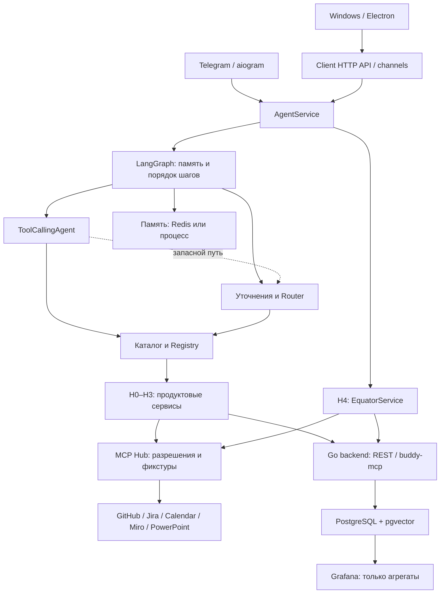

# AI-buddy · Архитектура

Актуализировано 15.11.2026. [Продукт](1_PRODUCT.md), [статус](3_ROADMAP.md),
[подробная структура Python](../agent/README.md), [историческая архитектура](archive/2026-11-15/2_ARCHITECTURE.md).

## 1. Компоненты



Python 3.12 отвечает за интерфейсы, агентный цикл, Router, H0–H4, MCP-клиенты и LLM.
Go 1.24 — за REST, собственный read-only MCP, авторизацию, PostgreSQL и миграции goose.
Redis 7 используется для live-памяти диалога при конфигурации; PostgreSQL 16 + pgvector —
для постоянных данных и необязательного векторного поиска. Grafana читает агрегаты.
Фоновые проверки реализованы asyncio-циклами в `scheduler/jobs.py`; APScheduler в текущем
коде не используется. React/Electron — дополнительный Windows-клиент.

## 2. Жизненный цикл и зависимости

`app.py` создаёт клиентов и HTTP/polling, запускает фоновые задачи и закрывает ресурсы.
`bootstrap.py` собирает AccessService, TeamService, BriefService и PlaybookService.
`Runtime` передаёт сервисам слой данных, MCP gateway, проверку Telegram-участников
и источник времени. DemoController подставляет SeedData, фикстуры и время шага.

`AgentService` — фасад текстовых и интерактивных операций. `InteractionState` содержит
словари известных чатов, пользователей, ожиданий ответа/карточки и соответствий брифов.
`ScenarioResult` описывает текст/источники/сущности; `ExecutorResponse` добавляет
совместимые поля доставки. `presentation.Action` пока поддерживает callback-строки:
полное отделение семантических действий от интерфейса не завершено.

## 3. Два пути выполнения

При `AGENT_ENGINE=graph`, `AGENT_MODE=agent` и совместимой настоящей LLM:

```text
load_memory → agent → Registry → продуктовые сервисы → guard → save_memory
```

Агент выбирает один или несколько продуктовых инструментов. Их результаты содержат
метки источников; код проверяет и преобразует их в ссылки. Лимиты агентного цикла:
3 обращения к модели, 4 продуктовых вызова и timeout 20 секунд по умолчанию.
Продуктовый вызов может включать несколько программных MCP-проверок.

Если модель сломалась после выполненного инструмента, доступен проверенный результат.
Если результата нет, граф использует правила уточнения и Router:

```text
load_memory → resolve_followup → route → execute → guard → save_memory
```

При fake/отключённой LLM доступен Router с правилами. `AGENT_ENGINE=legacy` использует
прямой Router → Registry. Граф задаёт порядок шагов; агентный цикл выбирает инструменты
внутри узла. Кнопки/расписание обходят Router. Файловый H4 — отдельный вход фасада.

## 4. Каталог и границы

`orchestration/catalog.py` задаёт 16 Router-кейсов и два фоновых триггера
(`brief_render`, `access_events`). Из записей получаются имена, параметры и JSON-схема
Router, описания LLM-инструментов, роли и адаптеры Registry. H4 и действия кнопок
не открываются модели автоматически. Пользователь/команда/роль приходят из доверенного Context.

MCP-политики проверяются независимо в `mcp_hub/policy.py` и Hub. Есть discovery,
валидация схем, read-only allowlist, таймауты и аудит. Лимиты шагов LLM не заменяют
права пользователя и серверную проверку своей команды в buddy-mcp.

Явные вопросы о назначении команд обрабатываются со справкой `prompts/commands.py`:
инструменты не исполняются, при сбое модели есть точный текст. Прямые команды
сохраняют обработчики. Персональные и медицинские темы блокируются программным путём.

## 5. Интеграции и данные

| Связь | Назначение |
|---|---|
| Agent → готовые MCP | Read-only GitHub/Jira/Calendar/Miro; PowerPoint — только чтение текста |
| Agent → buddy-mcp | Профиль, карточка своей команды, FAQ, каталог, отметки и стажёры |
| Agent → backend REST | Брифы, снимки, вопросы/ответы, FAQ, оценки, имитации, история H4 и трассы |
| Agent → Telegram API | Polling, доставка ответов/подтверждённых эскалаций, read-only membership-проверки |
| Desktop → agent HTTP API | Авторизованный дополнительный пользовательский канал |

buddy-mcp использует `/mcp` и `X-Buddy-Key` + `X-Buddy-User`; разрешения проверяются
на каждом запросе. Точные REST-схемы: [backend/openapi.yaml](../backend/openapi.yaml),
публичный клиентский API: [desktop/openapi.yaml](../desktop/openapi.yaml).
Секрет сервиса не передаётся desktop-клиенту.

Имитации доступов и прогресса существуют и хранят состояние в backend/SeedData:
[MOCK_SERVICES.md](../backend/MOCK_SERVICES.md). Это отдельный разрешённый путь записи,
не изменение реальных корпоративных сервисов.

Конфигурация MCP, закреплённые версии и серверные allowlist:
[mcp/README.md](../mcp/README.md). Демо не требует живых корпоративных серверов.
PowerPoint поднимается отдельным overlay и работает без корпоративного аккаунта.

## 6. H0–H4

| Пакет | Ответственность |
|---|---|
| `brief/` | Сбор изменений, сравнение календаря, ranking, главное действие, доставка и сигналы |
| `access/` | Проверки пяти сервисов, задача Jira, запрос в имитацию, мониторинг и сводка |
| `team/` | Восемь внутренних типов, FAQ, источники и эскалация |
| `rag/` | Ingestion, чанки, BM25, e5/pgvector, RRF, ответ и порог отказа |
| `equator/` | PDF/PPTX, структура/факты, рекомендации, версии и состояния доставки |

H0 фиксирует доставку перед продвижением since/снимка. Ссылки строит код по данным,
не модель; редирект `/r/<token>` использует случайные токены. H3 имеет fallback BM25
при недоступном векторном поиске. H4 разделяет обязательную проверку, рекомендации,
отметку прогресса и доставку файла/отчёта. Файлы после извлечения текста удаляются
из временного пространства; история результатов хранится отдельно. Дополнительный
канал может сохранять оригинал вложения приватно в PostgreSQL по своему контракту.

## 7. Состояние и ограничения

| Данные | Где и сколько |
|---|---|
| Продуктовые данные live | PostgreSQL, миграции и серверная авторизация |
| Данные demo | SeedData и фикстуры, изоляция сессий; session state сбрасывается при рестарте |
| Диалог | По умолчанию 6 ходов / 30 минут; Redis в live при настройке, процесс в demo |
| Чаты/ожидания/связи брифов | InteractionState текущего процесса, связи брифов ограничены 1024 |
| История H4 | PostgreSQL live, SQLite в постоянном томе demo; по умолчанию 7 дней |
| Трассы | Backend PostgreSQL, retention по умолчанию 30 дней |

Память разделяется по пользователю, команде и роли, в демо — также по сессии.
История не является свежим источником персональных фактов. После рестарта
получатели фоновых задач снова регистрируются при обращении.

## 8. Наблюдаемость и метрики

`observability/llm_trace.py` журналирует вызовы LLM, `turn_trace.py` формирует JSON хода,
`sink.py` отправляет его в backend. При отказе записи ответ пользователю не блокируется,
поэтому телеметрия может быть неполной. Studio показывает тот же граф на демо.

Grafana получает только `metrics_briefs`, `metrics_helpful`, `metrics_access`,
`metrics_mcp`, `metrics_agent` через отдельную SQL-роль. Raw-тексты и персональные
трейсы ей не выдаются. Текущий `metrics_agent` агрегирует demo и live вместе.
Новые разрезы и события пока описаны как план в [METRICS.md](METRICS.md), а не реализованы.

## 9. Структура и эксплуатация

```text
agent/       Python: orchestration, bot, channels, H0–H4, MCP, memory, prompts
backend/     Go REST/buddy-mcp, store и SQL-миграции
desktop/     Windows React/Electron и клиентский контракт
mcp/         готовые MCP и read-only обёртки
seed/        синтетические профили, карточки, каталог и правила имитаций
fixtures/    воспроизводимые ответы и учебные презентации
data/        снимок публичного playbook
evals/       наборы, скрипты и отчёты качества
infra/       Compose-проверки, Grafana и PostgreSQL init
openspec/    действующие спецификации, активные изменения и архив
docs/        продукт, архитектура, статус, метрики и исторические документы
reports/     доказательства проверок; plans/ — исторические рабочие планы
```

Старые Python-пути сохранены как совместимые импорты; новый код использует
`orchestration/`, `contracts.py`, `observability/`. Не удалять их как дубли.
Запуск/настройка окружения: [корневой README](../README.md).
Опубликованные порты loopback не заменяют авторизацию; туннель desktop направляется
только на пользовательский HTTP API агента, не на внутренние сервисы.
